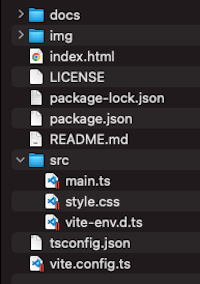

# cesium-starter


Start Cesium easily.  
- [Cesium v1.146.0](https://github.com/CesiumGS/cesium)  
- [TypeScript v7.0.2](https://www.typescriptlang.org)  
- [Vite v8.3.3](https://vitejs.dev)  
- node v24.21.0
- pnpm v11.9.0

<br>

## Usage



<br>

Install package

```bash
pnpm install --frozen-lockfile
```

<br>

dev
```bash
pnpm run dev
```

<br>

build

```bash
pnpm run build
```

<br>
<br>


<br>

## License
MIT

Copyright (c) 2022-2026 Yasunori Kirimoto

<br>

---

<br>

### Japanese

<br>

# Cesium スターター


Cesiumを手軽に始める
- [Cesium v1.146.0](https://github.com/CesiumGS/cesium)  
- [TypeScript v7.0.2](https://www.typescriptlang.org)  
- [Vite v8.3.3](https://vitejs.dev)  
- node v24.21.0
- pnpm v11.9.0

<br>

##  使用方法


<br>

パッケージインストール

```bash
pnpm install --frozen-lockfile
```

<br>

開発

```bash
pnpm run dev
```

<br>

ビルド

```bash
pnpm run build
```

<br>
<br>


<br>

## ライセンス
MIT

Copyright (c) 2022-2026 Yasunori Kirimoto

<br>
